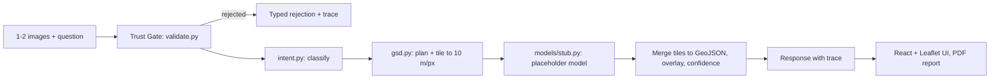

# SatQuery AI

An agentic front end for satellite imagery questions. Upload one or two GeoTIFF/PNG images and ask in plain English; the system validates the input, classifies the question, normalises the imagery to a model-friendly scale, and returns an answer with a map overlay, coordinates, a confidence value and a step-by-step execution trace.

> **Important: the vision-language model is a stub.** All model output comes from `backend/models/stub.py`, which returns canned answers and never looks at pixels. Everything else (geospatial handling, validation, intent routing, tiling, the UI and the PDF report) is real working code.

**Links:** [GitHub](https://github.com/shriram-s7/satquery)

## Overview

Built for Smart India Hackathon 2026, problem statement 26167 (ISRO). Real satellite scenes differ in sensor type, resolution (GSD) and coordinate system, and a model trained on one scale gives meaningless answers on another. SatQuery's pipeline is designed around that: a "Trust Gate" rejects inputs that cannot be answered reliably (with a typed reason), and a GSD-adaptive step resamples accepted imagery into the model's training domain (10 m/px, 120x120 px patches) before any model call. Because the model is a placeholder, answers are demonstration output only.

## Features

- **Input inspection** (`POST /api/inspect`): CRS, GSD, bands, dtype, size, WGS84 bounds, modality guess and a preview.
- **Trust Gate validation:** typed rejections `NOT_GEOSPATIAL`, `UNREADABLE`, `WRONG_IMAGE_COUNT`, `NO_SPATIAL_OVERLAP`, `CRS_MISMATCH`, `MODALITY_MISMATCH`, `BAND_COUNT_UNSUPPORTED`, `RESOLUTION_OUT_OF_RANGE`.
- **Intent classification:** rule-based routing to `vqa`, `captioning`, `grounding`, `change_detection`, `fusion` or `unknown`, with a confidence value and the matched signals; two-image queries boost change-detection and fusion.
- **GSD-adaptive normalisation:** a plan (scale factor, strategy, tile grid, rationale) and real tiling and reprojection with rasterio.
- **Results:** answer text, overlay regions, GeoJSON, confidence bar, evidence canvas, Leaflet map and a full execution trace (`step`, `detail`, `duration_ms`).
- **PDF report** (`POST /api/report`) built from a query response.

## How it works



`orchestrator.py` runs validate -> classify -> route -> merge. For change-detection the stub returns fixed regions that line up only with the synthetic `optical_t1.tif` / `optical_t2.tif` fixtures (documented in `fixtures/GROUND_TRUTH.md`).

## Tech stack

| Layer | Technology |
|---|---|
| Backend | Python 3.12, FastAPI, Uvicorn |
| Geospatial | rasterio (GDAL), pyproj, shapely, NumPy, Pillow |
| Reports | ReportLab |
| Frontend | React, Vite, Tailwind CSS, Leaflet / react-leaflet |
| State | In-memory only; no database |
| Tests | pytest |

## Project structure

```text
backend/
  main.py          FastAPI app: /api/health, /inspect, /query, /report
  geo.py           GeoTIFF reading, CRS, GSD, bounds, overlap
  validate.py      Trust Gate and typed rejections
  gsd.py           GSD-adaptive normalisation and tiling
  intent.py        rule-based intent classifier
  orchestrator.py  the agent loop
  models/stub.py   placeholder model (not a trained model)
  report.py        PDF report
  test_*.py        unit tests
frontend/          Vite React app (components for upload, map, evidence, trace, rejection)
fixtures/          synthetic GeoTIFFs and ground truth; generate.py recreates them
```

## Getting started

Prerequisites: Python 3.12 and Node 20+. rasterio ships GDAL wheels for Windows and Linux. No environment variables are needed.

**Windows (PowerShell)**

```powershell
python -m venv .venv
.\.venv\Scripts\Activate.ps1
python -m pip install -r requirements.txt
python -m uvicorn backend.main:app --port 8000
```

```powershell
cd frontend
npm install
npm run dev        # http://localhost:5173, proxies /api to port 8000
```

**Linux / macOS**

```bash
python3 -m venv .venv && source .venv/bin/activate
python -m pip install -r requirements.txt
python -m uvicorn backend.main:app --port 8000
# second terminal
cd frontend && npm install && npm run dev
```

Note: `requirements.txt` is saved as UTF-16 by PowerShell; recent pip versions read it, but if yours does not, re-save it as UTF-8. The backend only allows the origin `http://localhost:5173`.

## Usage

1. Open http://localhost:5173.
2. Drop in fixtures from `fixtures/`, for example `optical_t1.tif` and `optical_t2.tif`, and ask "What changed between these images?".
3. Try the rejection paths with `not_geo.png`, `corrupt.tif`, `far_away.tif` (no overlap) or the SAR file paired with an optical one.
4. Inspect the trace, then download the PDF report.

## Tests

```powershell
python -m pytest backend
```

Observed while writing this README: **59 passed** in about 3 seconds. The frontend has no tests (`npm run lint` uses oxlint; not run here).

## Status and limitations

- **No real model.** Answers, regions and confidence values are canned by the stub; do not treat them as analysis.
- Geospatial validation, normalisation and tiling are real, but have only been exercised on the small synthetic fixtures.
- Intent classification is keyword based.
- No authentication, persistence or multi-user support; the backend is for local use.
- Planned: integrate a trained vision-language model behind `models/stub.py`.

## License

No license specified.
